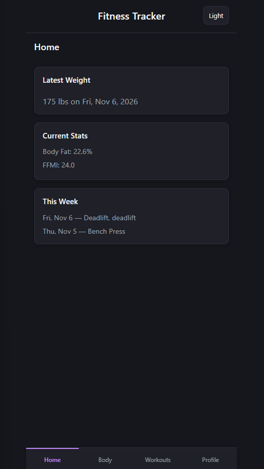
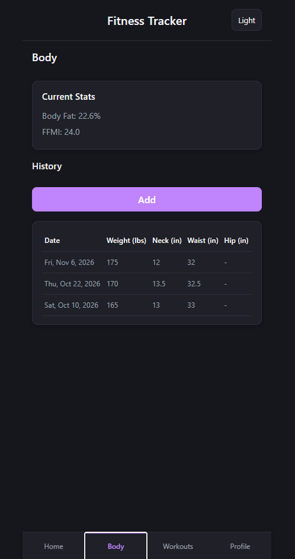
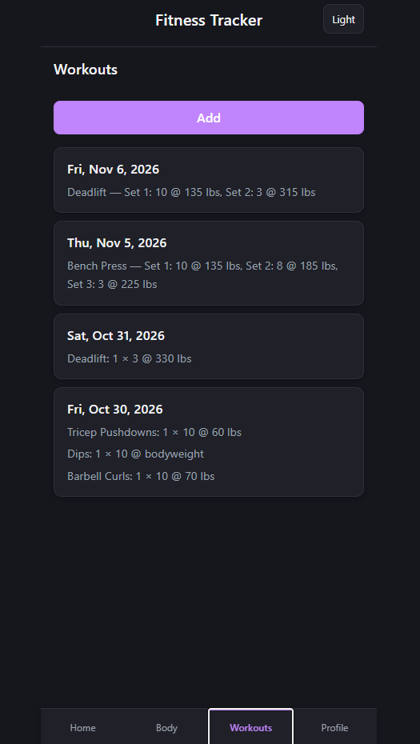
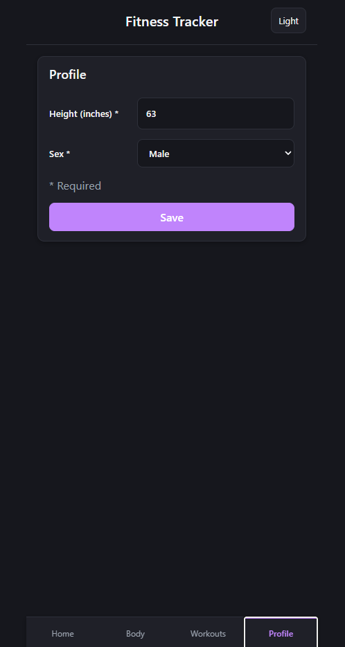
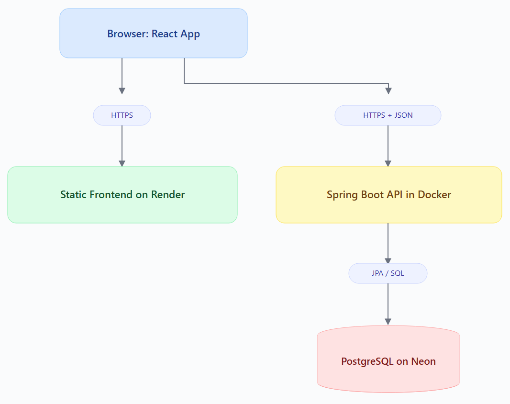

# Fitness Tracker

A mobile-first full-stack fitness tracking application built with React, Spring Boot, and PostgreSQL.

Track workouts and body measurements and calculate body fat percentage using the U.S. Navy method and Fat-Free Mass Index (FFMI).







You can demo the web app here: [fitness-tracker-bvkm.onrender.com ](https://fitness-tracker-bvkm.onrender.com/)

The app is hosted on Render's free plan so the first load after a quiet period can take up to a minute while the server wakes up. There is currently no login yet, so the live data is shared demo data. Please don't enter anything personal.


## What it does
- Body measurements: log weight, neck, waist and hip, and see your full history, newest first.
- Body composition: your current body fat % (U.S. Navy method) and FFMI (fat-free mass index), recalculated every time you log a measurement.
- Workouts: log a session with several exercises. Enter "3 sets × 10 reps @ 135 lbs" and the app stores each set individually. Bodyweight exercises are supported.
- Dashboard: latest weight, current stats and this week's workouts at a glance.
- Built for phones: a mobile-first layout with bottom navigation, plus light and dark themes.
- Clear errors: plain-language messages like "Weight is required." instead of technical ones, the same style on every screen.

This started as a Java command-line app (version 1), which I rebuilt as a full-stack web app.

## Tech stack

- Frontend: React, Vite, plain CSS, ESLint
- Backend: Java 25, Spring Boot 4 (Spring Web, Spring Data JPA / Hibernate, Bean Validation)
- Database: PostgreSQL, with schema migrations in Flyway
- Testing: JUnit 5, Mockito
- Deployment: Docker, Render (backend + static frontend), Neon (managed PostgreSQL)


## Architecture



The backend is organized in layers, each with one job:

- **Controller**: handles HTTP (URLs, status codes, JSON)
- **Service**: business logic (rules and calculations)
- **Repository**: reads and writes the database

Requests and responses use DTOs, separate from the database entities, so the API and the database can change independently.


## Design decisions
- Store the measurements, not the results. I store the original measurements in the database and calculate body fat percentage and FFMI when they're needed. This way, if I ever need to correct a formula, the updated results automatically apply to past measurements without having to update the database.
- Keep calculations separate from the database. MetricsService handles the body fat and FFMI calculations without needing to access the database. This keeps the logic simple, makes it easier to test, and separates calculations from the rest of the application.
- Manage database changes with Flyway. I use Flyway migrations to create and update the database schema with SQL scripts. Hibernate validates that the Java entities match the schema instead of generating tables automatically. This gives me more control over database changes and lets me track them in Git.
- Validate data at multiple levels. The frontend checks input before sending it, the backend validates incoming requests, and the database uses CHECK constraints to prevent invalid values from being stored. Each layer provides another opportunity to catch bad data.
- Reload data after changes. After creating or deleting a measurement or workout, the frontend fetches the updated data from the backend instead of trying to update the displayed information manually. This keeps the UI consistent with what's actually stored in the database.


## Bugs I found and fixed
- Wrong formula for women (from version 1). In the original terminal app, a scanner bug left gender empty, so everyone got the male body fat formula. Sex is now an enum, and a regression test fails if the female formula ever stops being used.
- Dates shifting by a day. Dates like 2026-11-06 were read as midnight UTC, which displays as Nov 5 in New York. I parse them as local dates now.
- Same-day entries in random order. Sorting by date alone doesn't define an order for ties in SQL, so a new measurement could show below an older one from the same day, and the stats used the wrong one. Fixed by also sorting by id (newest first).
- LazyInitializationException after hardening the config. Turning off Spring's open-in-view setting broke loading workouts, because their sets were loaded lazily after the database session had closed. The fix loads workouts and their sets in a single query, which also removed an N+1 query problem (one extra query per workout).

## Testing
- Unit tests for the body fat and FFMI calculations, using values checked by hand, plus edge cases: the female formula needs a hip measurement.
- Service tests with Mockito that replace the database with a fake repository.
- Every endpoint is also exercised with IntelliJ HTTP client files in backend/http/.


## Project structure
```
Fitness-Tracker/
├── backend/             Spring Boot API
│   ├── src/main/java/com/manny/fitness/
│   │   ├── controller/  HTTP endpoints
│   │   ├── service/     business logic and calculations
│   │   ├── repository/  database access
│   │   ├── model/       entities (database tables)
│   │   ├── dto/         request and response shapes
│   │   ├── config/      CORS
│   │   └── exception/   consistent error responses
│   ├── src/main/resources/db/migration/   Flyway SQL migrations
│   ├── http/            requests for testing the API
│   └── Dockerfile
├── frontend/            React app (Vite)
│   └── src/             screens, components, helpers
└── docs/                design docs, sketches, learning notes
```


## What's next

Planned additions:
- Login with Spring Security, so each person's data is private
- Weight trend chart on the dashboard
- Personal records and a strength score
- Goal-date prediction: a small machine-learning model that estimates when you'll reach a goal weight, evaluated against a simple baseline

## How I used AI

I designed the app (data model, API, screens), and wrote the database schema, the first backend features (profile, measurements, metrics) and their tests, and the first React screen by hand. For the rest, I used Claude Code as a pair programmer: I planned each feature, had it implement one piece at a time, reviewed every change, and tested everything myself. My rules for working with it are in CLAUDE.md.
