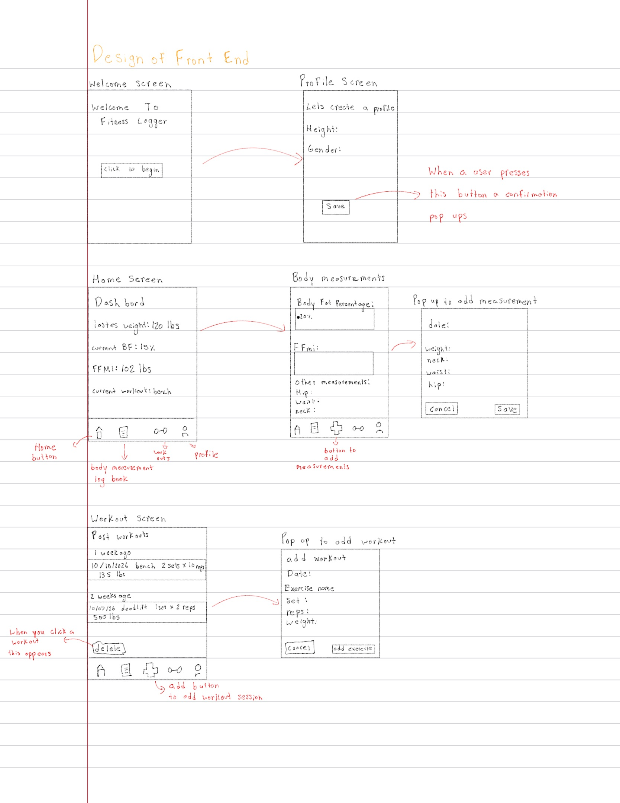

Frontend Design

Version 1 of Screens

 
```
App                      (owns: which tab is active, whether a profile exists)
├── WelcomeScreen        (only shown when there's no profile)
├── HomeScreen
│   ├── MetricsCard
│   └── WeekWorkoutsCard
├── BodyScreen           (owns: measurements list, metrics)
│   ├── MetricsCard
│   ├── MeasurementList
│   └── Modal → MeasurementForm
├── WorkoutsScreen       (owns: workouts list)
│   ├── WorkoutList → WorkoutCard
│   └── Modal → WorkoutForm → ExerciseRow
├── ProfileScreen
└── BottomNav

```
BodyScreen owns the measurements list and the metrics.
- After saving, the screen fetches the whole list again.
- While loading, the screen shows a spinner to show the user that a process is taking some time and to wait a little while.


| Component | Endpoint | When |
| --- | --- | --- |
| App | GET /api/profile | App opens: 404 means show WelcomeScreen |
| HomeScreen | GET /api/measurements, GET /api/metrics, GET /api/workouts | Screen opens |
| BodyScreen | GET /api/measurements, GET /api/metrics | Screen opens, and after a measurement is saved |
| MeasurementForm | POST /api/measurements | Save is pressed |
| WorkoutsScreen | GET /api/workouts | Screen opens, and after a workout is saved or deleted |
| WorkoutForm | POST /api/workouts | Save is pressed |
| WorkoutCard | DELETE /api/workouts/{id} | Delete is confirmed |
| ProfileScreen | GET /api/profile, PUT /api/profile | Screen opens / Save is pressed |